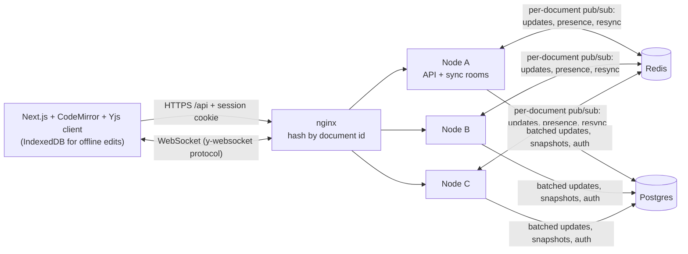

# Inkwell

A real-time collaborative Markdown editor (a minimal Google Docs) with workspaces, role-based sharing, and CRDT sync.

> **Status: Milestones 1–5 complete** — auth, workspaces, sharing, real-time CRDT editing with presence and offline merge, a horizontally scalable sync tier, version history with restore, anchored comments, full-text search, and a measured load test at 1,000 concurrent editors. Deployment and real-user metrics are not done yet; sections below say so rather than imply otherwise.

## Architecture



Routing is by **document**, so in steady state every editor of a document shares one room and Redis is idle; Redis keeps rooms consistent during failover, rebalancing and outages. Design decisions live in [docs/adr](docs/adr), the scaling one in [ADR 0005](docs/adr/0005-horizontal-scaling.md).

## Two versions

One codebase builds two versions of Inkwell, chosen by a feature flag:

|                               | Normal                                                              | AI                                    |
| ----------------------------- | ------------------------------------------------------------------- | ------------------------------------- |
| Flags                         | `AI_FEATURES=false`, `NEXT_PUBLIC_AI_FEATURES=false` (the defaults) | both `true`                           |
| AI UI                         | none, and the AI code is not in the web bundle                      | AI button and panel                   |
| AI routes (`/ai/*`, `/ws/ai`) | not registered: **404**                                             | registered, sign-in required          |
| LLM and search keys           | never read                                                          | read from the server environment only |

The flags are tested from both sides: with the flag off the AI module is never loaded, no AI route or
WebSocket answers, and a recording environment proves no key is read; with it on the routes exist,
require a session and never return key values. CI runs the whole server suite, the web build check and
the end-to-end suite in both modes (the LLM is never contacted). Each version deploys as its own
instance with its own database and address: see [docs/deploy.md](docs/deploy.md) and
[ADR 0007](docs/adr/0007-ai-feature-flag.md). Only the normal instance is meant to be deployed first,
and nothing is deployed yet.

## Quickstart

```bash
git clone https://github.com/<you>/InkWell && cd InkWell
npm install
cp .env.example .env && docker compose up -d postgres   # Postgres on :5432
npm run migrate -w apps/server && npm run dev -w apps/server
curl -s localhost:4000/healthz                          # {"ok":true}
```

Run the tests with `npm test` — no setup needed locally (it boots an embedded Postgres). Dev sign-in:
`curl -c jar -H 'content-type: application/json' -d '{"email":"me@example.com"}' localhost:4000/auth/dev-login`.
Dev login only works from localhost (and never in production).

### Run the 3-node cluster

```bash
docker compose -f docker-compose.cluster.yml build server-a && docker compose -f docker-compose.cluster.yml up -d
npm run cluster:demo -w apps/server      # cross-node sync timing + sticky-routing check
docker compose -f docker-compose.cluster.yml down -v
```

### GitHub sign-in (manual test checklist)

Register an OAuth app at GitHub → Settings → Developer settings → OAuth Apps. Homepage URL
`http://localhost:3000`; **callback URL `http://localhost:4000/auth/github/callback`** (the API
handles the callback, then redirects to the web app). Put the id/secret in `.env`; never commit it.

- [ ] Open `http://localhost:4000/auth/github` → GitHub consent page appears
- [ ] Approve → redirected to `WEB_ORIGIN`, `GET /me` returns your GitHub profile
- [ ] `GET /workspaces` shows a personal workspace with role `owner`
- [ ] `POST /auth/logout`, then `GET /me` returns 401

## Results

Hardware for everything below: Intel Core i5-1240P (16 logical cores), 63.7 GiB RAM, Windows 11, Node 20.16, PostgreSQL 18.4 (embedded) or 17 (Docker), Docker Desktop. The machine is **shared with other CPU-heavy jobs**, so treat timings as indicative, not as capacity claims.

| What                                                               | Result                                                                                                                                                                                                                                                                      |
| ------------------------------------------------------------------ | --------------------------------------------------------------------------------------------------------------------------------------------------------------------------------------------------------------------------------------------------------------------------- |
| Server tests                                                       | 81 passing, 10 skipped without Redis; 89.5% line coverage (`apps/server/src`)                                                                                                                                                                                               |
| Cluster tests on real Redis 7                                      | the same scenarios pass on the in-process bus and on Redis                                                                                                                                                                                                                  |
| Convergence property tests                                         | 200 + 60 + 25 randomised runs, 0 counterexamples; plus bus-outage and reconnect convergence                                                                                                                                                                                 |
| Playwright (two users, offline, viewer, comments, history, search) | 10 passing                                                                                                                                                                                                                                                                  |
| 3-node Docker cluster: cross-node propagation                      | p50 4.2 ms, p95 18.6 ms, max 42.4 ms over 60 edits (each node limited to 0.5 CPU; host-side timing, ~2 ms resolution, includes two Docker Desktop network hops)                                                                                                             |
| 3-node Docker cluster: sticky routing                              | 5 of 5 clients of one document landed on a single node                                                                                                                                                                                                                      |
| **Sync latency, 1,000 concurrent editors (k6)**                    | **p50 2 ms, p95 4 ms, p99 8 ms**, max 235 ms; 0 dropped connections, 0 errors. 100 documents × 10 editors, one edit per user per 2 s (~500 edits/s, ~4,500 deliveries/s), 3 sync nodes at 0.5 CPU each, one laptop. Details and caveats: [bench/README.md](bench/README.md) |
| Same load without document-affinity routing                        | p95 15 ms, p99 69 ms; sync nodes pinned at their CPU cap; Postgres CPU 2.5× higher (one run each)                                                                                                                                                                           |

### Search (20,000 documents × 250 words; table 103 MB, GIN index 18 MB; the user can see 20% of documents)

300 queries through the real access-filtered query, 20 results with highlighted snippets each. Synthetic Zipf-like vocabulary, single client, sequential queries. Reproduce with `npx tsx bench/search-bench.ts`; raw numbers in [bench/results/](bench/results).

| Query type                         | With GIN index (p50 / p95) | Without index (p50 / p95) |
| ---------------------------------- | -------------------------- | ------------------------- |
| rare term                          | **5.1 / 7.2 ms**           | 124 / 156 ms              |
| two terms (AND)                    | 8.1 / 16 ms                | 129 / 188 ms              |
| phrase                             | 5.4 / 174 ms               | 110 / 161 ms              |
| medium term                        | 18 / 202 ms                | 126 / 182 ms              |
| common term (in ~80% of documents) | 138 / 225 ms               | 127 / 202 ms              |

Selective queries are ~25× faster with the index. For terms that match most documents the planner correctly prefers a sequential scan and the cost is ranking thousands of matches; that is the known slow case (see Limitations). Query shape was chosen with `bench/search-lab.ts`, which checks that every variant returns identical ordered results before timing it: the page-first query cut overall p95 from 189 to 159 ms.

## Trade-offs

- **CRDT vs OT:** Yjs (CRDT). The server relays and stores opaque updates instead of transforming operations, so offline edits merge by construction and any node can accept any update, which is what makes the scaling design simple. The cost is metadata growth (tombstones, client ids), handled by compaction. Details in [ADR 0003](docs/adr/0003-yjs-sync-and-persistence.md).
- **Consistency vs latency:** document content is eventually consistent. Local edits apply instantly; other clients on the same node see them after one WebSocket hop and clients on other nodes after one more Redis hop (single-digit milliseconds in the measurement above). Authorization is the opposite: checked server-side at connect time and re-checked every 15 s, so a revoked share can stay writable for up to that window. Updates are batched for 100 ms before hitting Postgres, trading a tiny crash window for far fewer writes.
- **Scaling: stickiness plus Redis, not either alone.** Document-affinity routing makes cross-node traffic near zero in steady state; Redis pub/sub makes the unlucky cases (node loss, rebalancing, a split document) correct. Pub/sub is at-most-once, so nodes repair loss by exchanging state vectors on join and on reconnect rather than relying on a durable log. Measured: with affinity, p95 sync latency at 1,000 editors was 4 ms; without it 15 ms, with the sync nodes saturated (see Results). See [ADR 0005](docs/adr/0005-horizontal-scaling.md).
- **History, comments and search design:** [ADR 0006](docs/adr/0006-history-comments-search.md).
- **How convergence is tested:** see [ADR 0004](docs/adr/0004-testing-convergence.md).

## Limitations

- The load test uses lite clients (real Yjs updates, no per-user document replica) because a full replica per virtual user saturated k6 itself; it is one run per configuration on one shared laptop with Docker Desktop networking, so it shows the design works at 1,000 editors, not where it breaks. The next limit looks like the Postgres write path (persisting each active room every 100 ms, search re-indexing, periodic access re-checks).
- A document's room still lives in one node's memory; scaling is across documents, not within one huge document. Throughput limits are measured in milestone 5.
- Search ranking cost grows with the number of matching documents you can see, so queries made only of very common words are the slow case (~140 ms median at 20k documents). Search results can lag edits by ~2 s while a document is open.
- Version history stores full states (automatic versions pruned to 100 per document); comments are not part of the CRDT, so they are not versioned or restored.
- The cluster setup has no automatic Redis failover (single Redis instance); while it is down, nodes serve their own clients and resync on recovery.
- Presence identity (name/colour) is asserted by the client, so a malicious editor could spoof a label. Document access control is unaffected.
- Offline edits are kept in IndexedDB per browser profile; clearing site data before reconnecting loses unsynced edits.
- Revoked access takes up to the 15 s re-auth interval to cut a live socket.
- Users can only be shared with after signing in once (no email invites or public links).
- Live GitHub OAuth HTTP calls are covered by a manual checklist, not automated tests.
- The end-to-end offline test simulates going offline by closing the provider connection, not by cutting the network.
- The cluster compose file serves the API and sync tier only; the web app runs separately until deployment (milestone 6). The single-node `docker-compose.yml` has not been run.
- Migrations are forward-only.

## What I'd do next

M6 deployment, Sentry, uptime checks → M7 real users. Engineering follow-ups from the load test: coalesce `documents.updated_at` writes and batch update inserts across rooms, adaptive flush intervals under load, and a ceiling test (raise the edit rate and editor count until the sync tier, not the generator, saturates).
