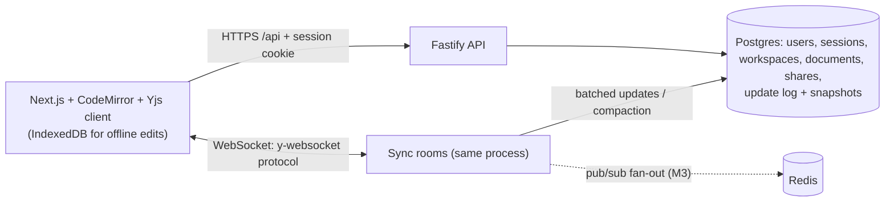

# Inkwell

A real-time collaborative Markdown editor (a minimal Google Docs) with workspaces, role-based sharing, and CRDT sync.

> **Status: Milestones 1–2 complete** — auth, workspaces, sharing, and real-time CRDT editing with presence, offline merge and persistence. Horizontal scaling, version history, search, deployment and user metrics are not built yet; sections below say so rather than imply otherwise.

## Architecture



Dashed edges are planned. Design decisions live in [docs/adr](docs/adr).

## Quickstart

```bash
git clone https://github.com/<you>/InkWell && cd InkWell
npm install
cp .env.example .env && docker compose up -d postgres   # Postgres on :5432
npm run migrate -w apps/server && npm run dev -w apps/server
curl -s localhost:4000/healthz                          # {"ok":true}
```

Run the tests with `npm test` — no setup needed locally (it boots an embedded Postgres). Dev sign-in:
`curl -c jar -H 'content-type: application/json' -d '{"email":"me@example.com"}' localhost:4000/auth/dev-login`.
Dev login only works from localhost (and never in production).

### GitHub sign-in (manual test checklist)

Register an OAuth app at GitHub → Settings → Developer settings → OAuth Apps. Homepage URL
`http://localhost:3000`; **callback URL `http://localhost:4000/auth/github/callback`** (the API
handles the callback, then redirects to the web app). Put the id/secret in `.env`; never commit it.

- [ ] Open `http://localhost:4000/auth/github` → GitHub consent page appears
- [ ] Approve → redirected to `WEB_ORIGIN`, `GET /me` returns your GitHub profile
- [ ] `GET /workspaces` shows a personal workspace with role `owner`
- [ ] `POST /auth/logout`, then `GET /me` returns 401

## Results

Measured on a Windows 11 laptop (Node 20.16, embedded Postgres 18.4, Chromium via Playwright) that was shared with other CPU-heavy jobs, so treat timings as indicative only.

| What                                                               | Result                                                   |
| ------------------------------------------------------------------ | -------------------------------------------------------- |
| Server tests (unit, HTTP, real WebSocket, persistence, properties) | 43 passing, 90.9% line coverage of `apps/server/src`     |
| Convergence property tests                                         | 200 + 60 + 25 randomised runs, 0 counterexamples         |
| Playwright, two simulated users + viewer + offline                 | 6 passing (2.9 min wall time including dev-server start) |
| Sync latency at 1,000 concurrent editors (k6)                      | _not measured yet (M5)_                                  |

Reproduce: `npm test` (server) and `npm run test -w e2e` (browser). Benchmarks will live in [bench/](bench).

## Trade-offs

- **CRDT vs OT:** Yjs (CRDT). The server relays and stores opaque updates instead of transforming operations, so offline edits merge by construction and any server can accept any update (the basis for M3). The cost is metadata growth (tombstones, client ids), handled by compaction. Details in [ADR 0003](docs/adr/0003-yjs-sync-and-persistence.md).
- **Consistency vs latency:** document content is eventually consistent — local edits apply instantly and converge once messages are exchanged. Authorization is the opposite: it is checked on the server at connect time and re-checked every 15 s, so a revoked share can stay writable for up to that window. Updates are batched for 100 ms before hitting Postgres, trading a tiny crash window for far fewer writes ([ADR 0003](docs/adr/0003-yjs-sync-and-persistence.md)).
- **How convergence is tested:** see [ADR 0004](docs/adr/0004-testing-convergence.md).

## Limitations

- Single sync process: rooms live in memory on one server. Horizontal scaling is milestone 3.
- Presence identity (name/colour) is asserted by the client, so a malicious editor could spoof a label. Document access control is unaffected.
- Offline edits are kept in IndexedDB per browser profile; clearing site data before reconnecting loses unsynced edits.
- Revoked access takes up to the 15 s re-auth interval to cut a live socket.
- Users can only be shared with after signing in once (no email invites or public links).
- Live GitHub OAuth HTTP calls are covered by a manual checklist, not automated tests.
- The end-to-end offline test simulates going offline by closing the provider connection, not by cutting the network.
- Migrations are forward-only. Docker image build and compose have not yet been run on this machine.

## What I'd do next

M3 Redis-coordinated sync servers with sticky sessions → M4 version history, comments, full-text search → M5 k6 load test at 1,000 editors → M6 deployment, Sentry, uptime checks → M7 real users.
