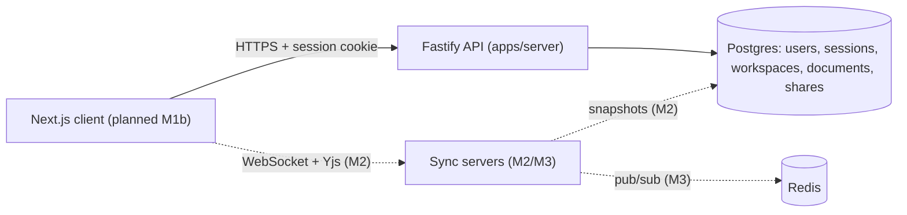

# Inkwell

A real-time collaborative Markdown editor (a minimal Google Docs) with workspaces, role-based sharing, and CRDT sync.

> **Status: Milestone 1 of 7 — auth, workspaces, documents and sharing (API).** Real-time sync, scaling, search, deployment and user metrics are not built yet; sections below say so rather than imply otherwise.

## Architecture



Dashed edges are planned. Design decisions live in [docs/adr](docs/adr).

## Quickstart

```bash
git clone https://github.com/<you>/InkWell && cd InkWell
npm install
cp .env.example .env && docker compose up -d postgres   # Postgres on :5432
npm run migrate -w apps/server && npm run dev -w apps/server
curl -s localhost:4000/healthz                          # {"ok":true}
```

Run the tests with `npm test` — no setup needed locally (it boots an embedded Postgres). Dev sign-in:
`curl -c jar -H 'content-type: application/json' -d '{"email":"me@example.com"}' localhost:4000/auth/dev-login`.
For real GitHub sign-in, fill `GITHUB_CLIENT_ID/SECRET` in `.env`.

## Results

| Milestone | Measured                                               | Environment                                    |
| --------- | ------------------------------------------------------ | ---------------------------------------------- |
| M1        | 25 tests passing, 89.8% line coverage (`src/`)         | Node 20.16, embedded Postgres 18.4, Windows 11 |
| M5        | _p95 sync latency at 1,000 editors — not measured yet_ | —                                              |

Benchmarks will live in [bench/](bench) with the hardware and dataset used.

## Trade-offs (to be expanded as M2–M3 land)

- **CRDT vs OT:** planned choice is Yjs (CRDT) — no central transform server, offline edits merge by construction, at the cost of metadata growth and tombstones. Full ADR in M2.
- **Consistency vs latency:** CRDTs give eventual consistency with local-first latency; permission changes (checked server-side) are the one place we need strong consistency.

## Limitations

- No UI yet; the API is exercised through tests and `curl`.
- Users can only be shared with after signing in once (no email invites or public links).
- Live GitHub OAuth HTTP calls are not covered by automated tests (only the flow via a fake provider).
- Migrations are forward-only.

## What I'd do next

M1b Next.js UI → M2 Yjs sync + presence + snapshots → M3 Redis-coordinated WebSocket scaling.
