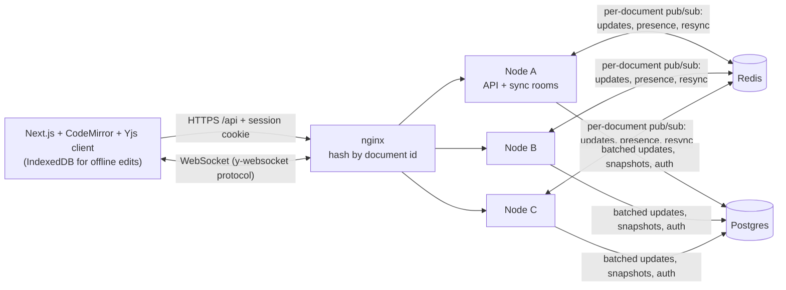

# Inkwell

A real-time collaborative Markdown editor (a minimal Google Docs) with workspaces, role-based sharing, and CRDT sync.

> **Status: Milestones 1–3 complete** — auth, workspaces, sharing, real-time CRDT editing with presence, offline merge and persistence, and a horizontally scalable sync tier (Redis fan-out, document-affinity routing). Version history, search, load testing, deployment and user metrics are not built yet; sections below say so rather than imply otherwise.

## Architecture



Routing is by **document**, so in steady state every editor of a document shares one room and Redis is idle; Redis keeps rooms consistent during failover, rebalancing and outages. Design decisions live in [docs/adr](docs/adr), the scaling one in [ADR 0005](docs/adr/0005-horizontal-scaling.md).

## Quickstart

```bash
git clone https://github.com/<you>/InkWell && cd InkWell
npm install
cp .env.example .env && docker compose up -d postgres   # Postgres on :5432
npm run migrate -w apps/server && npm run dev -w apps/server
curl -s localhost:4000/healthz                          # {"ok":true}
```

Run the tests with `npm test` — no setup needed locally (it boots an embedded Postgres). Dev sign-in:
`curl -c jar -H 'content-type: application/json' -d '{"email":"me@example.com"}' localhost:4000/auth/dev-login`.
Dev login only works from localhost (and never in production).

### Run the 3-node cluster

```bash
docker compose -f docker-compose.cluster.yml build server-a && docker compose -f docker-compose.cluster.yml up -d
npm run cluster:demo -w apps/server      # cross-node sync timing + sticky-routing check
docker compose -f docker-compose.cluster.yml down -v
```

### GitHub sign-in (manual test checklist)

Register an OAuth app at GitHub → Settings → Developer settings → OAuth Apps. Homepage URL
`http://localhost:3000`; **callback URL `http://localhost:4000/auth/github/callback`** (the API
handles the callback, then redirects to the web app). Put the id/secret in `.env`; never commit it.

- [ ] Open `http://localhost:4000/auth/github` → GitHub consent page appears
- [ ] Approve → redirected to `WEB_ORIGIN`, `GET /me` returns your GitHub profile
- [ ] `GET /workspaces` shows a personal workspace with role `owner`
- [ ] `POST /auth/logout`, then `GET /me` returns 401

## Results

Measured on a Windows 11 laptop (16 logical cores, Node 20.16, Docker Desktop) that was **shared with other CPU-heavy jobs**, so treat timings as indicative only.

| What                                               | Result                                                                                                                                                          |
| -------------------------------------------------- | --------------------------------------------------------------------------------------------------------------------------------------------------------------- |
| Server tests                                       | 52 passing, 8 skipped without Redis; 87% line coverage (`apps/server/src`)                                                                                      |
| Cluster tests on real Redis 7                      | 17 of 17 passing (same scenarios on the in-process bus and on Redis)                                                                                            |
| Convergence property tests                         | 200 + 60 + 25 randomised runs, 0 counterexamples; plus bus-outage and reconnect convergence                                                                     |
| Playwright, two simulated users + viewer + offline | 6 passing                                                                                                                                                       |
| 3-node Docker cluster: cross-node propagation      | p50 4.2 ms, p95 18.6 ms, max 42.4 ms over 60 edits (each node limited to 0.5 CPU; host-side timing, ~2 ms resolution, includes two Docker Desktop network hops) |
| 3-node Docker cluster: sticky routing              | 5 of 5 clients of one document landed on a single node                                                                                                          |
| Sync latency at 1,000 concurrent editors (k6)      | _not measured yet (M5)_                                                                                                                                         |

Reproduce: `npm test` (server; set `REDIS_URL` to include the Redis scenarios), `npm run test -w e2e` (browser), and the cluster numbers with the commands in the quickstart. Benchmarks will live in [bench/](bench).

## Trade-offs

- **CRDT vs OT:** Yjs (CRDT). The server relays and stores opaque updates instead of transforming operations, so offline edits merge by construction and any node can accept any update, which is what makes the scaling design simple. The cost is metadata growth (tombstones, client ids), handled by compaction. Details in [ADR 0003](docs/adr/0003-yjs-sync-and-persistence.md).
- **Consistency vs latency:** document content is eventually consistent. Local edits apply instantly; other clients on the same node see them after one WebSocket hop and clients on other nodes after one more Redis hop (single-digit milliseconds in the measurement above). Authorization is the opposite: checked server-side at connect time and re-checked every 15 s, so a revoked share can stay writable for up to that window. Updates are batched for 100 ms before hitting Postgres, trading a tiny crash window for far fewer writes.
- **Scaling: stickiness plus Redis, not either alone.** Document-affinity routing makes cross-node traffic near zero in steady state; Redis pub/sub makes the unlucky cases (node loss, rebalancing, a split document) correct. Pub/sub is at-most-once, so nodes repair loss by exchanging state vectors on join and on reconnect rather than relying on a durable log. See [ADR 0005](docs/adr/0005-horizontal-scaling.md).
- **How convergence is tested:** see [ADR 0004](docs/adr/0004-testing-convergence.md).

## Limitations

- A document's room still lives in one node's memory; scaling is across documents, not within one huge document. Throughput limits are measured in milestone 5.
- The cluster setup has no automatic Redis failover (single Redis instance); while it is down, nodes serve their own clients and resync on recovery.
- Presence identity (name/colour) is asserted by the client, so a malicious editor could spoof a label. Document access control is unaffected.
- Offline edits are kept in IndexedDB per browser profile; clearing site data before reconnecting loses unsynced edits.
- Revoked access takes up to the 15 s re-auth interval to cut a live socket.
- Users can only be shared with after signing in once (no email invites or public links).
- Live GitHub OAuth HTTP calls are covered by a manual checklist, not automated tests.
- The end-to-end offline test simulates going offline by closing the provider connection, not by cutting the network.
- The cluster compose file serves the API and sync tier only; the web app runs separately until deployment (milestone 6). The single-node `docker-compose.yml` has not been run.
- Migrations are forward-only.

## What I'd do next

M4 version history, comments, full-text search → M5 k6 load test at 1,000 editors → M6 deployment, Sentry, uptime checks → M7 real users.
